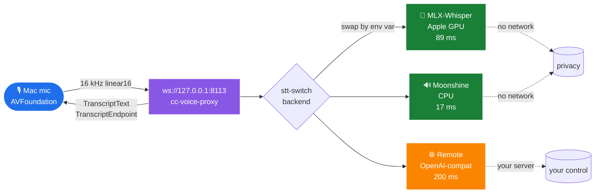

<div align="center">

# 🎙️ stt-switch

### Route Claude Code voice mode to a local STT engine of your choice

**Apple Silicon native · zero outbound traffic on the happy path · drop-in replacement for `api.anthropic.com → Deepgram`**

[](https://opensource.org/licenses/MIT)
[](https://www.apple.com/mac/)
[](https://www.python.org/)
[](https://github.com/ml-explore/mlx)
[](#-privacy-posture)
[](#contributing)

```
┌────────────────────────────────────────────────────────────────────────┐
│                                                                        │
│   89 ms warm  •  16 backends  •  one env var  •  zero cloud calls     │
│                                                                        │
└────────────────────────────────────────────────────────────────────────┘
```

</div>

---

## 🚀 The pitch in one paragraph

Claude Code's `/voice` mode streams every word you say to `api.anthropic.com → Deepgram`. Two third-parties, no in-product opt-out. **stt-switch** flips one env var (`VOICE_STREAM_BASE_URL`) to redirect the audio to a local WebSocket proxy that speaks the same Anthropic protocol. Your speech is transcribed on-device by your choice of 16 backends — including Whisper-large-v3-turbo on Apple Silicon GPU at **89 ms warm**, faster than the network round-trip to Deepgram. One CLI command swaps backends. MIT licensed. ✨

---

## ⚡ Quick demo

```bash
# Install
pip install "git+https://github.com/gitjfmd/stt-switch.git#egg=stt-switch[mlx,moonshine]"

# Wire it up (adds env var + launchd agent)
stt-switch wire

# Pick the engine
stt-switch mlx-whisper-large-v3-turbo

# Open a NEW terminal so the env var is picked up
claude        # /voice as usual — audio never leaves your Mac
```

Revert any time with `stt-switch unwire`.

---

## 🏗️ Architecture



The proxy speaks Anthropic's **decoded** [`voice_stream` protocol](docs/PROTOCOL.md) (not Deepgram's wire format — that's the trap most people fall into). Authentication is unchanged; CC still writes its OAuth bearer, the proxy ignores it.

---

## ⏱️ Latency leaderboard (Apple M5 Max, 3-second clip)

```
mlx-whisper-base-en           ▏ 14 ms     ▏▏▏░░░░░░░░░░░░░░░░░░░░░░░░░░░░░░░░░░░  🏆 fastest accurate
moonshine-onnx-tiny           ▏ 17 ms     ▏▏▏▏░░░░░░░░░░░░░░░░░░░░░░░░░░░░░░░░░░  
moonshine-onnx-base           ▏ 30 ms     ▏▏▏▏▏▏▏░░░░░░░░░░░░░░░░░░░░░░░░░░░░░░░  
mlx-whisper-small-en          ▏ 40 ms     ▏▏▏▏▏▏▏▏▏░░░░░░░░░░░░░░░░░░░░░░░░░░░░░  
moonshine-stream-tiny         ▏ 73 ms     ▏▏▏▏▏▏▏▏▏▏▏▏▏▏▏▏░░░░░░░░░░░░░░░░░░░░░░  
mlx-whisper-large-v3-turbo    ▏ 89 ms     ▏▏▏▏▏▏▏▏▏▏▏▏▏▏▏▏▏▏▏░░░░░░░░░░░░░░░░░░░  ⭐ recommended
mlx-whisper-distil-large-v3   ▏ 90 ms     ▏▏▏▏▏▏▏▏▏▏▏▏▏▏▏▏▏▏▏░░░░░░░░░░░░░░░░░░░  
mlx-chain                     ▏ 93 ms     ▏▏▏▏▏▏▏▏▏▏▏▏▏▏▏▏▏▏▏▏░░░░░░░░░░░░░░░░░░  ⭐ chain w/ fallback
mlx-whisper-large-v3          ▏147 ms     ▏▏▏▏▏▏▏▏▏▏▏▏▏▏▏▏▏▏▏▏▏▏▏▏▏▏▏▏▏▏▏▏░░░░░░  
remote-moonshine              ▏208 ms     ▏▏▏▏▏▏▏▏▏▏▏▏▏▏▏▏▏▏▏▏▏▏▏▏▏▏▏▏▏▏▏▏▏▏▏▏▏▏  
remote-chain                  ▏197 ms     ▏▏▏▏▏▏▏▏▏▏▏▏▏▏▏▏▏▏▏▏▏▏▏▏▏▏▏▏▏▏▏▏▏▏▏▏▏▏  
moonshine-stream-medium       ▏280 ms     ▏▏▏▏▏▏▏▏▏▏▏▏▏▏▏▏▏▏▏▏▏▏▏▏▏▏▏▏▏▏▏▏▏▏▏▏▏▏▏ + cont
remote-speaches (cloud GPU)   ▏412 ms     ▏▏▏▏▏▏▏▏▏▏▏▏▏▏▏▏▏▏▏▏▏▏▏▏▏▏▏▏▏▏▏▏▏▏▏▏▏▏▏ + cont

   ──── reference ────
deepgram via api.anthropic.com (cloud) ~ 300–500 ms typical (Anthropic + Deepgram + network)
```

> **Most people should default to `mlx-chain`**: MLX whisper-large-v3-turbo runs locally at ~89 ms; on the rare empty transcript it cascades to a remote `large-v3` for accuracy. Best privacy + best accuracy + best latency, all at once.

---

## 🎛️ Backend catalog

<table>
<tr><th>Backend</th><th>Best for</th><th>Profiles</th></tr>

<tr><td>

**🍎 MLX-Whisper**

Apple's native ML framework, runs on the GPU + Neural Engine.

</td><td>

Lowest latency on Apple Silicon. Whisper accuracy.

</td><td>

`mlx-whisper-tiny-en` `mlx-whisper-base-en` `mlx-whisper-small-en` `mlx-whisper-medium-en` `mlx-whisper-medium` `mlx-whisper-distil-large-v3` `mlx-whisper-large-v3-turbo` `mlx-whisper-large-v3`

</td></tr>

<tr><td>

**🔊 Moonshine**

UsefulSensors' tiny ASR — purpose-built for streaming.

</td><td>

Sub-30 ms commands. CPU-only, no Apple Silicon required.

</td><td>

`moonshine-onnx-tiny` `moonshine-onnx-base` `moonshine-stream-tiny` `moonshine-stream-medium` `moonshine-hf-base`

</td></tr>

<tr><td>

**📚 faster-whisper**

CTranslate2-quantized Whisper, cross-platform.

</td><td>

CPU baseline if MLX isn't an option.

</td><td>

`whisper-faster-base` `whisper-faster-large-v3`

</td></tr>

<tr><td>

**🌐 Remote OpenAI-compatible**

Any server with `/v1/audio/transcriptions`. [Speaches](https://github.com/speaches-ai/speaches), self-hosted Whisper, anything.

</td><td>

Offload to your own GPU server. Configurable via env.

</td><td>

`remote-moonshine` `remote-speaches` `remote-chain`

</td></tr>

<tr><td>

**🔗 Chains**

Try fast/local first; fall back to a stronger model on empty/error.

</td><td>

Best accuracy + latency + privacy combo.

</td><td>

`mlx-chain` ⭐ `remote-chain`

</td></tr>

</table>

---

## 🔧 Installation

```bash
# Most users — MLX backends + Moonshine
pip install "git+https://github.com/gitjfmd/stt-switch.git#egg=stt-switch[mlx,moonshine]"

# Everything (largest install, all backends ready)
pip install "git+https://github.com/gitjfmd/stt-switch.git#egg=stt-switch[all]"

# MLX only (smallest install, fastest path on Apple Silicon)
pip install "git+https://github.com/gitjfmd/stt-switch.git#egg=stt-switch[mlx]"
```

### From source

```bash
git clone https://github.com/gitjfmd/stt-switch.git
cd stt-switch
pip install -e ".[all]"
```

### System dependencies

```bash
brew install ffmpeg                 # required (audio conversion)
brew install espeak-ng              # only if using TTS profiles (not for STT)
```

---

## 💻 CLI

| Command | What it does |
|---|---|
| `stt-switch` | Interactive picker (current marked) |
| `stt-switch list` | Show every profile |
| `stt-switch current` | Show what's running now |
| `stt-switch <profile>` | Set + reload (e.g. `stt-switch mlx-chain`) |
| `stt-switch reload` | Reload without changing profile |
| `stt-switch bench` | Latency leaderboard against the catalog |
| `stt-switch wire` | Install + start the proxy, route Claude Code to it |
| `stt-switch unwire` | Full revert |

```
$ stt-switch
STT backend switcher
Current: mlx-chain

  ▸  1. moonshine-onnx-base
     2. moonshine-onnx-tiny
     3. moonshine-stream-tiny
     ...
    11. mlx-whisper-large-v3-turbo
    12. ▸ mlx-chain
    ...
Pick a number (or blank to cancel):
```

---

## 🧪 How the protocol decode works

Claude Code's `/voice` mode opens a WebSocket to `api.anthropic.com/api/ws/speech_to_text/voice_stream`. Anthropic wraps Deepgram in their own simpler JSON shape — sending Deepgram-native messages back will silently fail (the client ignores them and renders **"no speech detected"**, which is what we kept hitting at first).

The decoded protocol — verified by reading the publicly leaked Claude Code source:

```jsonc
// Server → client
{"type":"TranscriptText",      "data":"your transcribed words"}
{"type":"TranscriptEndpoint"}
{"type":"TranscriptError",     "error_code":"...", "description":"..."}

// Client → server
binary linear16 PCM frames
{"type":"KeepAlive"}                 // every ~8 s
{"type":"CloseStream"}               // on key release / finalize
```

Full notes: [**docs/PROTOCOL.md**](docs/PROTOCOL.md) (with credit to the [reverse-engineering community](https://github.com/ComeOnOliver/claude-code-analysis)).

---

## 🛡️ Privacy posture

<table>
<tr><td width="50%">

### Default (mlx-chain)

```
    🎙️  →  ws://127.0.0.1:8113  →  🍎 MLX-Whisper  →  📝
                ↑                          ↑
       loopback only                 in-process

         ZERO OUTBOUND TRAFFIC
```

</td><td width="50%">

### What Claude Code does without us

```
    🎙️  →  wss://api.anthropic.com  →  🌐 Deepgram  →  📝
                                   
            ✗ Anthropic sees audio
            ✗ Deepgram sees audio
            ✗ no in-product opt-out
```

</td></tr>
</table>

- **No private hostnames or IPs** are baked in. Remote endpoints require explicit env vars (`STT_SWITCH_REMOTE_*_URL`); the repo ships none.
- **Loopback bind only** (`127.0.0.1`). The proxy never touches a network interface, never trips your firewall.
- **Optional clone capture** (off by default). Set `STT_SWITCH_LUXTTS_URL` to opt in.
- **Audio never lands on disk** unless you turn on capture, in which case it's posted to your own server.

---

## 📦 Optional: voice-clone capture

When the proxy gets a non-empty transcript with sane duration (3–30 s by default), it can fire-and-forget the audio + transcript to a [LuxTTS](https://github.com/ysharma3501/LuxTTS) server you run, growing your voice clone library automatically as you talk to Claude Code.

```bash
# Enable
export STT_SWITCH_LUXTTS_URL=https://your-luxtts-host:17860

# Disable
export STT_SWITCH_CAPTURE_ENABLED=0
```

Files land at `voices/mac/cc/<timestamp>.wav` on your LuxTTS server.

---

## ⚠️ Caveats

| | |
|---|---|
| 🍎 | **MLX requires Apple Silicon.** Intel Macs use Moonshine ONNX or faster-whisper-cpu. |
| 🐧 | **Linux/Windows aren't first-class yet.** Proxy itself is plain Python and runs fine; the wire/unwire scripts use macOS launchd. systemd-user PRs welcome. |
| 📥 | **First model load downloads weights** (large MLX ~1 GB; cached after). Subsequent loads are sub-second. |
| 🔤 | **Letter-acronyms can mishear** ("STT" → "ETS"). Use `mlx-whisper-large-v3` or `remote-speaches` for absolute accuracy. |
| 🔓 | **Anthropic's voice gating still applies.** This redirects where audio *goes*, not whether the binary will send it. |
| 🔄 | **Restart `claude` after `stt-switch wire`** — the binary reads the env var once at startup. |

---

## 🙏 Credits

This project rests on a stack of excellent open-source work:

- [**Anthropic**](https://www.anthropic.com/) — for shipping Claude Code with the `VOICE_STREAM_BASE_URL` env var that makes this whole thing possible
- [**MLX**](https://github.com/ml-explore/mlx) + [**mlx-whisper**](https://github.com/ml-explore/mlx-examples/tree/main/whisper) — Apple's ML framework + Whisper port
- [**useful-moonshine-onnx**](https://github.com/usefulsensors/moonshine) — UsefulSensors Moonshine ONNX
- [**faster-whisper**](https://github.com/SYSTRAN/faster-whisper) — CTranslate2-quantized Whisper
- [**Speaches**](https://github.com/speaches-ai/speaches) — OpenAI-compatible STT/TTS server (used for the `remote-speaches` profile)
- [**Claude Code reverse-engineering community**](https://github.com/ComeOnOliver/claude-code-analysis) — for decoding the voice_stream protocol from the publicly available source

---

## 👤 About the author

Built by **[Dr. Junaid Farooq, M.D.](https://jfmd.dev)** — a board-certified physician (Internal Medicine, Infectious Diseases) who codes, building at the intersection of medicine, AI infrastructure, and security.

He runs hospital medicine by day and ships open-source medical/AI tooling by night through his companies:

- 🏥 **[OpenMedica](https://openmedica.dev)** *(IntelMedica)* — *"reclaiming the future of medicine"* with open-source, **physician-governed** medical AI tools (747+ skills, FDA data, clinical guidelines, drug interactions, the Open Medical Skills marketplace)
- 🔐 **[SECSOLS](https://secsols.io)** — MCP-native infrastructure for AI-agent payments and identity (AgenticPay, Ephemeral Cards, Agent Identity Protocol)
- 🩺 **RN Scribe** — nursing documentation software for clinical environments

`stt-switch` was born out of the same impulse that drives the rest of his work: **infrastructure for autonomous AI agents should be private-first, on-device when possible, and built for the people who actually use it.** A physician dictating to a coding agent shouldn't have their voice routed through two third-parties to get a transcript back.

Find him at:
- 🌐 **[jfmd.dev](https://jfmd.dev)** — the personal site
- 🐦 **[@jfmdid](https://x.com/jfmdid)** on X
- 💼 **[linkedin.com/in/jfmdid](https://linkedin.com/in/jfmdid)** on LinkedIn
- 🐙 **[@gitjfmd](https://github.com/gitjfmd)** on GitHub

[](https://jfmd.dev)
[](https://x.com/jfmdid)
[](https://linkedin.com/in/jfmdid)

---

## 🤝 Contributing

PRs welcome. Areas where help would land especially well:

- 🐧 Linux systemd-user variant of `wire-cc-voice.sh` / `unwire-cc-voice.sh`
- 🪟 Windows support (proxy already runs; needs equivalent of launchd registration)
- 🟢 NVIDIA CUDA path for `whisper-faster-large-v3` and Moonshine
- 🎛️ Live partial transcripts (interim `TranscriptText` events during speech)
- 📊 PyPI publish + GitHub Action that runs `stt-bench.py` on every PR

---

<div align="center">

**MIT License · made on Apple Silicon · audio stays on device**

[](https://github.com/gitjfmd/stt-switch)

</div>
